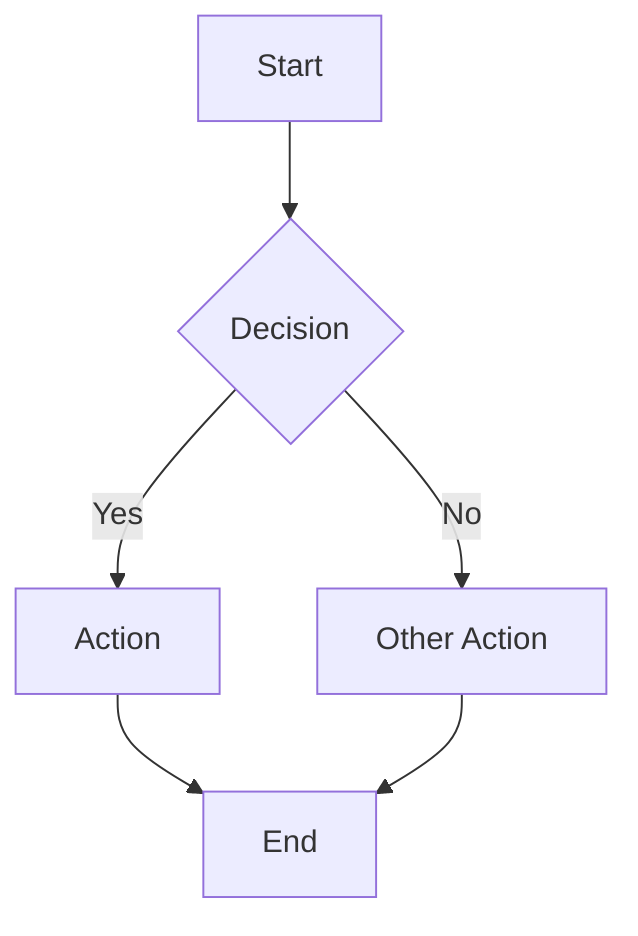
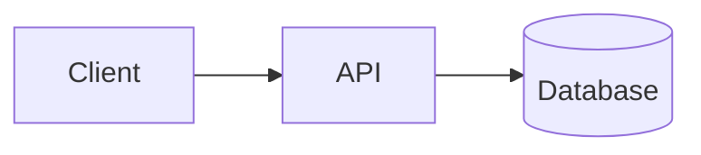
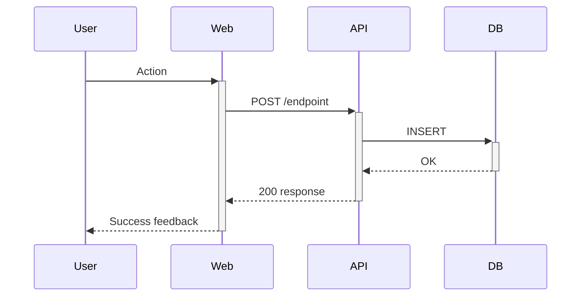
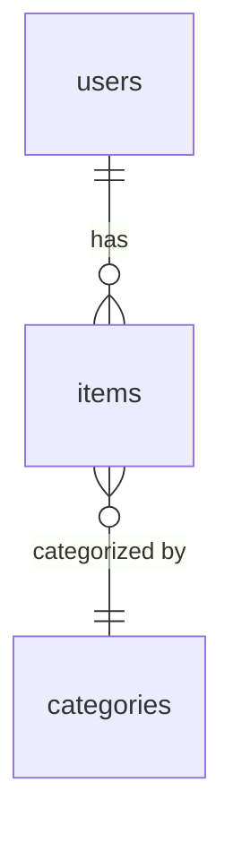
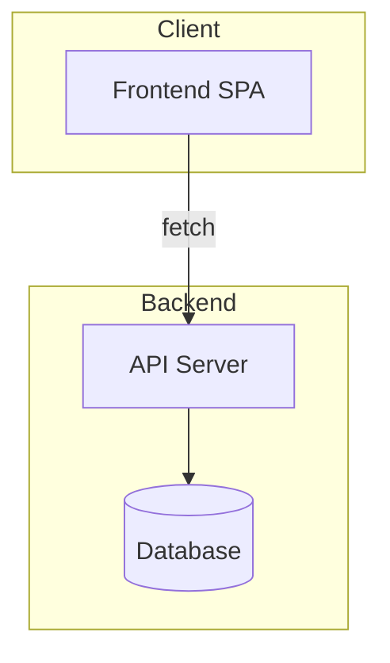

# Skill: Documentation Generator

Create, update, and maintain the project documentation types below in Markdown under `docs/`. Manual-only: a person runs it with `/docs-generator <type>`. The `docs-writer` agent does not depend on it (Claude Code keeps manual-only skills from being preloaded into subagents) and carries its own templates for flowchart, TDD, API reference, ERD and changelog. The argument picks the template by its number below: flowchart 1, tdd 2, frd 3, user-guide 4, api 5, erd 6, architecture 7, changelog 8, release-notes 9.

TDD and FRD are for as-built or approved work. A requirements spec written before implementation belongs to the `business-analyst` skill.

---

## Folder Structure

```
docs/
  flowcharts/          # Mermaid-based flow diagrams
  tdd/                 # Technical Design Documents
  frd/                 # Functional Requirements Documents
  user-guides/         # End-user guides and walkthroughs
  api/                 # API endpoint documentation
  erd/                 # Entity Relationship Diagrams
  architecture/        # Architecture diagrams and overviews
  changelog/           # CHANGELOG.md (single file, newest entries first)
  release-notes/       # Per-release notes (e.g., v1.2.0.md)
```

Create subfolders on first use. Do NOT dump all docs in a flat `docs/` root. Folders owned by other tools (`adr/`, `specs/`, `test-plans/`, `bugs/`, `reviews/`, `security/`) are left alone.

---

## Before Writing Any Doc

Reflect the **actual codebase**, not assumptions. These steps assume a web app with a SQL schema; adapt them for other stacks. Before writing:

1. **Read the schema** — the DB schema file is the source of truth for tables and columns. Use its table and column names verbatim (same spelling and case) in every diagram and table.
2. **Read relevant routes** — scan backend route files for endpoints, request/response shapes, middleware.
3. **Read relevant pages/components** — scan frontend pages for UI flows.
4. **Check existing docs** — read the target file first if it exists; update in place, don't overwrite.

Zero hallucinated details. Every table name, column, endpoint, and component must come from code you actually read.

---

## Doc Type Templates

### 1. Flowchart (`docs/flowcharts/<feature-name>.md`)

````markdown
# <Feature Name> — Flow

## Overview
Brief one-liner on what this flow covers.

## Diagram



## Notes
- Any edge cases, gotchas, or branching logic worth calling out.
````

---

### 2. TDD — Technical Design Document (`docs/tdd/<feature-name>.md`)

````markdown
# TDD: <Feature Name>

**Status:** Draft | Under Review | Approved | Implemented

## 1. Context & Problem
Why this feature exists. What problem it solves.

## 2. Goals & Non-Goals
| Goals | Non-Goals |
|-------|-----------|
| ...   | ...       |

## 3. Architecture Overview


## 4. Data Model
Tables involved, new columns/tables if any.

| Table | Column | Type | Notes |
|-------|--------|------|-------|
| ...   | ...    | ...  | ...   |

## 5. API Changes
New or modified endpoints with request/response shapes.

## 6. Frontend Changes
Pages, components, modals affected. Key state flows.

## 7. Sequence Diagram


## 8. Edge Cases & Risks

## 9. Migration Plan (if schema changes needed)
````

---

### 3. FRD — Functional Requirements Document (`docs/frd/<feature-name>.md`)

```markdown
# FRD: <Feature Name>

**Status:** Draft | Under Review | Approved | Implemented

## 1. Overview

## 2. Background & Motivation

## 3. Scope
### In Scope
### Out of Scope

## 4. Functional Requirements

### FR-1: <Requirement Title>
**Description:** ...
**Acceptance Criteria:**
- [ ] ...

## 5. User Stories
| # | As a... | I want to... | So that... |
|---|---------|-------------|------------|

## 6. UI/UX Requirements

## 7. Data Requirements

## 8. Dependencies

## 9. Open Questions
```

---

### 4. User Guide (`docs/user-guides/<feature-name>.md`)

Plain language, no code blocks unless showing UI text.

```markdown
# <Feature Name> — User Guide

## What is <Feature>?

## How to Use It

### Step 1: <Action>

### Step 2: <Action>

## Tips

## FAQ

## Troubleshooting
| Problem | Solution |
|---------|----------|
```

---

### 5. API Docs (`docs/api/<domain>.md`)

Generate from actual route files. Group by domain. The response envelope below (`success` / `data`) is an example: it must match the repo's real envelope.

````markdown
# API: <Domain>

## Endpoints

### `POST /endpoint`
**Auth:** Required
**Description:** What it does.

**Request Body:**
```json
{ "field": "type" }
```

**Response (200):**
```json
{ "success": true, "data": {} }
```

**Errors:**
| Code | Message | When |
|------|---------|------|
| 400  | ...     | ...  |
| 401  | ...     | ...  |
````

---

### 6. ERD (`docs/erd/<scope>.md`)

Use Mermaid `erDiagram` syntax. Generate from actual schema files, with the schema's table names verbatim in the diagram and in the detail section.

````markdown
# ERD: <Scope>

## Diagram



## Table Details

### items
| Column | Type | Notes |
|--------|------|-------|
| id     | TEXT | PK    |
````

---

### 7. Architecture Diagram (`docs/architecture/<topic>.md`)

````markdown
# Architecture: <Topic>

## Diagram



## Components
Brief description of each box and its responsibility.
````

---

### 8. Changelog (`docs/changelog/CHANGELOG.md`)

Single file, newest entries at the top: `[Unreleased]` first, then one dated or versioned heading per release (`## [1.2.0] - YYYY-MM-DD`, or `## [YYYY-MM-DD]` when the project has no versions). Each section is grouped under Added, Changed and Fixed (leave out a group with no entries in a released section). A security fix goes under Fixed.

```markdown
# Changelog

## [Unreleased]

### Added
### Changed
### Fixed

---

## [1.2.0] - YYYY-MM-DD

### Added
- <Feature description>

### Changed
- <Change description>

### Fixed
- <Bug fix description>
```

When updating: read `git log` since the last release heading, then add entries under `[Unreleased]`. At release, rename `[Unreleased]` to the dated or versioned heading and add a new empty `[Unreleased]` above it.

---

### 9. Release Notes (`docs/release-notes/<version-or-date>.md`)

User-facing summary. Less technical than changelog.

```markdown
# Release Notes — <Version or Date>

## Highlights

## New Features
- **<Feature>:** Plain-language description.

## Improvements

## Bug Fixes

## Known Issues
```

---

## Update Rules

- **Changelogs / release notes** — update after every major feature ship or significant bug fix.
- **API docs** — update whenever a route is added, changed, or removed.
- **ERDs** — update whenever the schema changes.
- **TDDs / FRDs** — set the `**Status:**` line to Implemented once shipped.
- When updating an existing doc, **read it first** and surgically update — don't rewrite unless asked.

## Naming Conventions

- kebab-case filenames: `budget-allocation.md`, not `BudgetAllocation.md`. The one exception is `CHANGELOG.md`.
- Architecture docs follow the same rule: `docs/architecture/<topic>.md` (for example `overview.md`), not `ARCHITECTURE.md`.
- Release notes: use date or version (`2026-04-16.md`, `v2.1.0.md`)

## Quality Checklist

```
□ All table/column names match the actual schema
□ All endpoints match actual route files
□ Mermaid diagrams have valid syntax
□ No "TBD" or "TODO" placeholders — fill or mark as Open Question
□ New docs linked from docs/README.md (if one exists)
```
